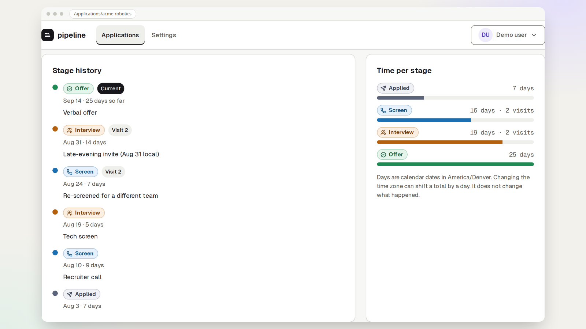

# pipeline

A job-search pipeline that keeps stage history instead of overwriting a status.



Sign in, or try the demo, and move an application through Applied, Screen, Interview, Offer, and Closed. The README image is captured from a local test build with `npm run readme-hero`. Set `HERO_BASE_URL` to recapture it against a deployed origin.

## Run locally

1. Create a Postgres database and copy the env file.

```bash
cp .env.example .env
```

2. Set `DATABASE_URL`, `SESSION_SECRET`, and `ENCRYPTION_KEY` in `.env`. Placeholders are in `.env.example`. Do not commit `.env`.

3. Install, migrate, and start the API and the client.

```bash
npm install
npm run db:migrate
npm run dev
```

The client runs at <http://localhost:5173> and proxies `/api` to the server on port 3000. Dev mail is printed to the server console because `RESEND_API_KEY` is unset. Tests use an in-memory mail sink instead.

## Stack

React 18, TypeScript, Vite, Tailwind CSS, TanStack Query, React Router, Hono, Drizzle, Postgres, zod, argon2id, vitest, Playwright.

## Deploy

`render.yaml` defines one Render web service. Postgres is external Neon. There is no Render database, and there is no `preDeployCommand`. The server applies migrations before it listens.

Render sets `NODE_ENV=production`, so the build installs devDependencies, builds the client, typechecks the server, then prunes devDependencies. `npm start` runs the API with `tsx` (a production dependency of the server) and serves `client/dist` on the same origin. Unknown non-API paths return the client HTML. `/api` stays on the API, including unknown API paths.

Neon pooled URLs (the hostname contains `-pooler`) go through PgBouncer in transaction mode. `drizzle-orm`'s migrator can apply this schema on that URL when prepared statements are off: the SQL is ordinary DDL, and a single runner finishes. It does not take its own lock, and a session-level `pg_advisory_lock` does not stay on one backend across statements in that pool mode, so two overlapping starts can race. Startup takes `pg_advisory_xact_lock` for the whole migration transaction instead. PgBouncer pins the backend until commit, so the pooled `DATABASE_URL` is enough. Set optional `DATABASE_URL_UNPOOLED` or `DIRECT_URL` (the direct host, no `-pooler`) when you want migrations on a direct connection. Queries still use `DATABASE_URL`. `DATABASE_URL_UNPOOLED` wins when both are set.

Render generates `SESSION_SECRET` and `ENCRYPTION_KEY` (`generateValue: true`). Each value is base64 of 32 bytes, 44 characters with one trailing `=`, for example `B0jrphAPOY7pg92AN0c9MN4yecczLMdwnx4OkA1KFUk=`. That meets the 32-character minimum. `SESSION_SECRET` is the HMAC string. `ENCRYPTION_KEY` is AES-256-GCM material for slice 2: that base64 form decodes to the raw 32 bytes. Any other string of at least 32 characters is hashed with SHA-256 to 32 bytes (`aes256Key`).

The owner sets `DATABASE_URL` (Neon pooled URL), `RESEND_API_KEY`, and `APP_URL` (public https origin, no path). `GITHUB_CLIENT_ID` and `GITHUB_CLIENT_SECRET` are optional and are not required to start. `DATABASE_URL_UNPOOLED` and `DIRECT_URL` are optional. The blueprint sets `MAIL_FROM` to `Pipeline <onboarding@resend.dev>`, `TRUSTED_PROXY_HOPS` to `1`, and Node 22.

The client IP is `TRUSTED_PROXY_HOPS` entries from the right of `X-Forwarded-For`. `0` ignores that header and uses the socket address. Unset defaults to `0`. Render's `1` is correct only because Render's proxy is the sole route to the app. A wrong hop count reopens IP spoofing. See `docs/SECURITY.md`.

I made history append-only so days-in-stage stays honest when a stage is revisited.

I made stages a fixed enum, not user-defined, so the demo stays small.

Notes live on the application and optionally on a stage event: the event note is what changed, the application note is the running summary.
